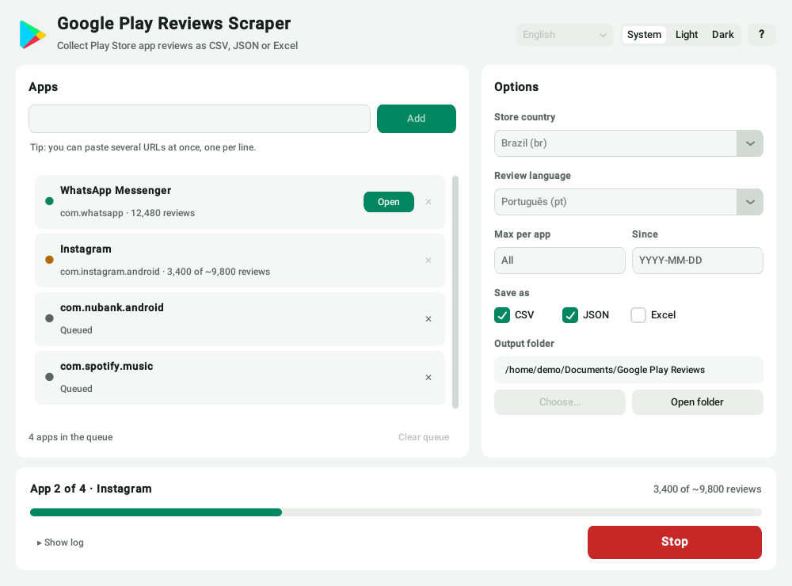

<div align="center">


# Google Play Reviews Scraper

**Collectez les avis du Google Play Store en CSV, JSON ou Excel — depuis une app de bureau ou le terminal.**

[🇺🇸 English](../README.md) · [🇧🇷 Português](README_PT.md) · [🇪🇸 Español](README_ES.md) · [🇫🇷 Français](README_FR.md) · [🇩🇪 Deutsch](README_DE.md) · [🇮🇹 Italiano](README_IT.md)



</div>

## Fonctionnalités

- **File de plusieurs apps** — collez des URL du Play Store ou des ID de paquet, même plusieurs d'un coup (un par ligne).
- **Juste ce qu'il vous faut** — tout, les *N* derniers par app, ou seulement les avis depuis une date.
- **CSV, JSON et Excel** — le CSV s'ouvre dans Excel avec les accents ; le JSON inclut les métadonnées de l'app.
- **Arrêt immédiat** — ce qui a déjà été collecté est conservé.
- **Robuste** — les erreurs réseau sont réessayées au lieu d'interrompre la collecte en silence.
- **Résumé des notes** — moyenne et répartition de 1 à 5★ à la fin.
- **Mode clair et sombre**, interface en 6 langues, mémorise vos réglages.
- **La même app sur Windows, macOS et Linux**, plus une CLI et une API Python.

<div align="center">

</div>

## Démarrage

### Windows — sans Python

Téléchargez l'installateur ou le `.exe` dans les [Releases](https://github.com/dssiqueira/google-play-reviews-scraper/releases) et lancez-le.

### Depuis les sources

```bash
git clone https://github.com/dssiqueira/google-play-reviews-scraper.git
cd google-play-reviews-scraper
pip install -r requirements.txt

python src/app_gui.py         # app de bureau
python src/review_scraper.py  # mode interactif dans le terminal
```

> **Linux :** Tk est souvent un paquet séparé — `sudo apt install python3-tk` (Debian/Ubuntu).

## Ligne de commande

```bash
# une app, par ID ou URL
python src/review_scraper.py com.whatsapp

# plusieurs apps, store US en anglais, 1 000 max. chacune, depuis le 1er janvier, en CSV + Excel
python src/review_scraper.py com.whatsapp com.instagram.android \
    --country us --lang en --max 1000 --since 2026-01-01 --format csv,xlsx
```

Toutes les options, l'API Python et le format des données sont dans le [README en anglais](../README.md).

## Bon à savoir

- **Combien d'avis puis-je récupérer ?** Autant que Google Play en fournit pour ce pays/cette langue — souvent moins que le total affiché, qui compte toutes les langues.
- **Est-ce autorisé ?** L'outil lit des pages publiques, comme un navigateur. Les avis contiennent des noms d'utilisateurs : traitez les données de façon responsable (RGPD) et respectez les conditions de Google Play.

Graphiques et analyse de sentiment ? Importez le JSON dans **[Review Stats Pro](https://review-stats-pro.lovable.app/)**.

## Licence

[MIT](../LICENSE) © Douglas Siqueira
