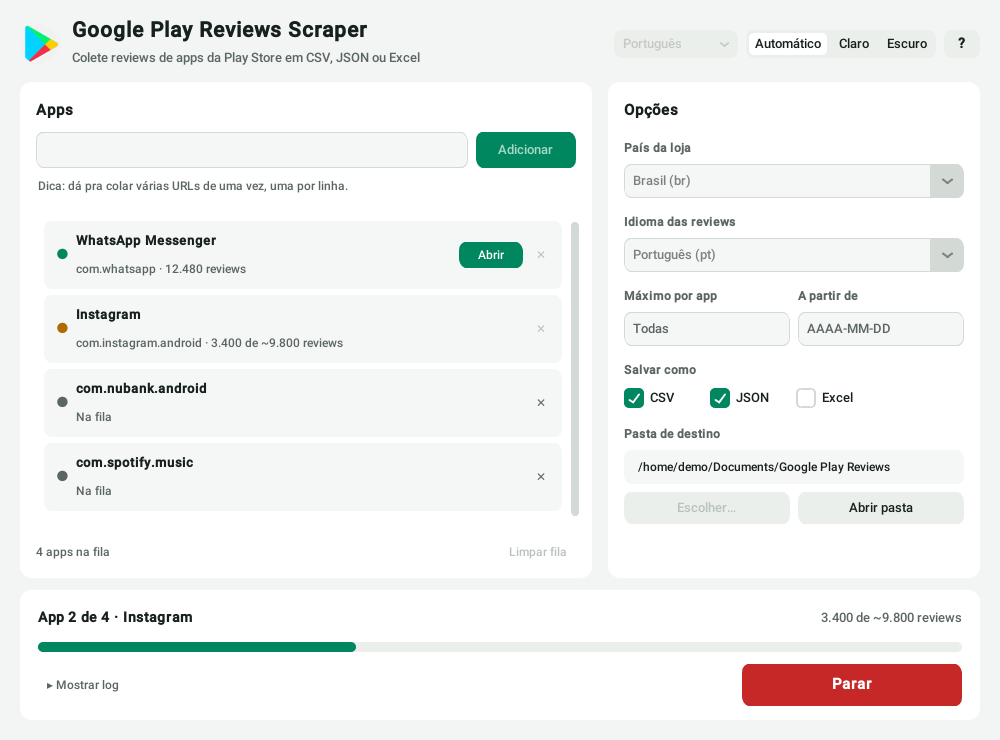
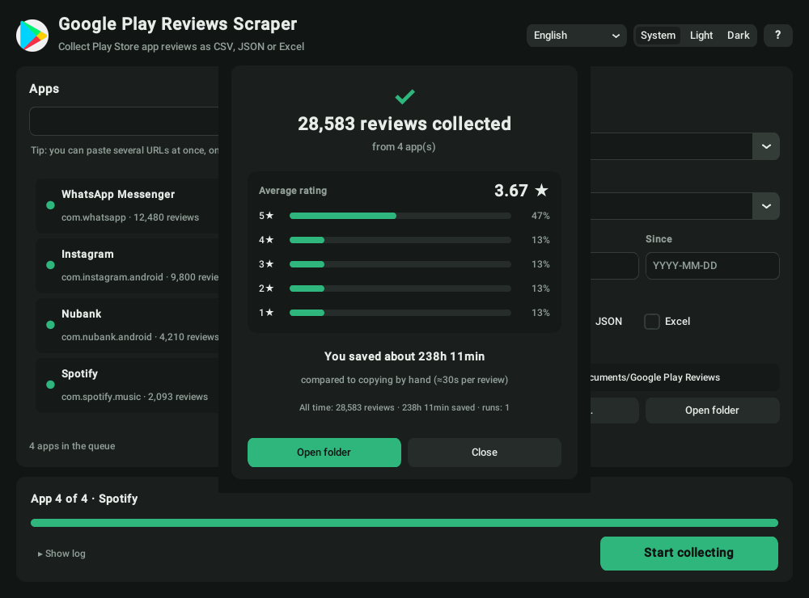

<div align="center">


# Google Play Reviews Scraper

**Colete reviews da Google Play Store em CSV, JSON ou Excel — pelo app de desktop ou pelo terminal.**

[🇺🇸 English](../README.md) · [🇧🇷 Português](README_PT.md) · [🇪🇸 Español](README_ES.md) · [🇫🇷 Français](README_FR.md) · [🇩🇪 Deutsch](README_DE.md) · [🇮🇹 Italiano](README_IT.md)



</div>

## O que ele faz

- **Fila com vários apps** — cole URLs da Play Store ou IDs de pacote, inclusive vários de uma vez (um por linha).
- **Colete só o que precisa** — tudo, as últimas *N* por app, ou só as reviews a partir de uma data.
- **CSV, JSON e Excel** — o CSV abre no Excel com acentuação certa; o JSON inclui os metadados do app.
- **Pare quando quiser** — o botão Parar é imediato e mantém o que já foi coletado.
- **Resiliente** — falhas de rede são retentadas com backoff, em vez de encerrar a coleta pela metade sem avisar.
- **Resumo das notas** — média e distribuição de 1 a 5★ ao fim de cada coleta.
- **Modo claro e escuro**, interface em 6 idiomas, lembra suas configurações.
- **O mesmo app no Windows, macOS e Linux**, além de CLI e API em Python.

<div align="center">

</div>

## Começando

### Windows — sem precisar de Python

Baixe o instalador ou o `.exe` em [Releases](https://github.com/dssiqueira/google-play-reviews-scraper/releases) e execute.

### Pelo código-fonte (Windows, macOS, Linux)

```bash
git clone https://github.com/dssiqueira/google-play-reviews-scraper.git
cd google-play-reviews-scraper
pip install -r requirements.txt

python src/app_gui.py         # app de desktop
python src/review_scraper.py  # modo interativo no terminal
```

> **Linux:** na maioria das distros o Tk vem separado — `sudo apt install python3-tk` (Debian/Ubuntu) ou `sudo dnf install python3-tkinter` (Fedora).

## Linha de comando

```bash
# um app, por ID ou URL
python src/review_scraper.py com.whatsapp
python src/review_scraper.py "https://play.google.com/store/apps/details?id=com.whatsapp"

# vários apps, loja dos EUA em inglês, até 1.000 cada, desde 1º de janeiro, em CSV + Excel
python src/review_scraper.py com.whatsapp com.instagram.android \
    --country us --lang en --max 1000 --since 2026-01-01 --format csv,xlsx --output-dir dados/
```

| Opção | Padrão | |
|---|---|---|
| `APP ...` | — | URLs da Play Store ou IDs de app |
| `-c, --country` | `br` | País da loja (`us`, `gb`, `pt`, …) |
| `-l, --lang` | `pt` | Idioma das reviews (`en`, `es`, …) |
| `-n, --max` | todas | Máximo de reviews por app |
| `--since` | — | Só reviews a partir de `AAAA-MM-DD` |
| `-f, --format` | `csv,json` | Qualquer combinação de `csv`, `json`, `xlsx` |
| `-d, --output-dir` | `.` | Pasta onde os arquivos são salvos |
| `-o, --output` | nome do app | Prefixo do arquivo (só com um app) |
| `-v, --verbose` | desligado | Mostra retentativas e detalhes |

Os arquivos levam o nome do app, por exemplo `whatsapp_messenger_reviews.csv`.

## API em Python

```python
from review_scraper import GooglePlayReviewScraper

scraper = GooglePlayReviewScraper(country="br", lang="pt")
result = scraper.scrape("com.whatsapp", max_reviews=500,
                        on_progress=lambda feitas, total: print(feitas, total))

print(result.title, len(result.reviews), result.complete)
print(scraper.statistics(result.reviews))   # total, média, distribuição 1-5★
scraper.save_reviews(result.reviews, result.app_info, output_dir="dados", formats=["csv", "xlsx"])
```

O `scrape()` também aceita `since=date(...)` e um `cancel_event=threading.Event()` que pode ser acionado de outra thread.

## Formato dos dados

Cada review tem as mesmas colunas em todos os formatos:

| Coluna | Exemplo |
|---|---|
| `review_id` | `gp:AOqpTOH…` |
| `user_name` | `Maria S.` |
| `content` | `App ótimo, mas…` |
| `score` | `4` |
| `thumbs_up_count` | `12` |
| `at` | `2026-10-01T14:32:10` |
| `reply_content` / `reply_at` | resposta do desenvolvedor, se houver |
| `app_version` | `2.26.4.71` |

O JSON envolve as reviews com `collection_info` (data, país, idioma) e o `app_info` completo da loja. Veja [`examples/`](../examples).

Quer gráficos e análise de sentimento? Suba o JSON no **[Review Stats Pro](https://review-stats-pro.lovable.app/)**.

## Bom saber

- **Quantas reviews dá pra pegar?** Tantas quanto a Google Play entrega para aquele país/idioma — normalmente menos que o total da página da loja, que soma todos os idiomas. O contador mostra esse total como `~N`.
- **Onde ficam minhas configurações?** Na pasta de dados do usuário (`%APPDATA%\GooglePlayReviewsScraper` no Windows, `~/Library/Application Support/…` no macOS, `~/.config/google-play-reviews-scraper` no Linux).
- **Pode usar?** A ferramenta lê páginas públicas de reviews, como um navegador. As reviews incluem nomes de usuários, então trate os dados com responsabilidade (LGPD) e respeite os termos da Google Play.

## Desenvolvimento

```bash
pip install -r requirements-dev.txt
pytest                      # os testes rodam offline contra uma Play Store simulada
ruff check src tests
python build.py             # app standalone em dist/
python build.py --installer # Windows: gera também o instalador (Inno Setup)
```

As traduções ficam em `src/translations.py`, e um teste garante que todo idioma tem todas as chaves. Contribuições são bem-vindas: abra uma [issue](https://github.com/dssiqueira/google-play-reviews-scraper/issues) ou um PR.

## Licença

[MIT](../LICENSE) © Douglas Siqueira
